<div align="center">


# el-Tru — E-Learning Trunojoyo

**Platform e-learning sederhana untuk dosen dan mahasiswa: kelola kelas, bagikan materi, dan kelola anggota.**


-orange)

</div>

> Proyek tugas kuliah **Pengembangan Aplikasi Web (PAW) 2019**, Universitas Trunojoyo Madura.
> Ditulis dengan PHP native + MySQL tanpa framework. Repo ini sudah ditambahi konfigurasi Docker
> supaya bisa dijalankan ulang dengan satu perintah.

## Daftar isi

- [Fitur](#fitur)
- [Tampilan](#tampilan)
- [Menjalankan di lokal](#menjalankan-di-lokal)
- [Akun demo](#akun-demo)
- [Teknologi](#teknologi)
- [Struktur database](#struktur-database)
- [Struktur folder](#struktur-folder)
- [Catatan & keterbatasan](#catatan--keterbatasan)
- [Deploy ke server / VPS](#deploy-ke-server--vps)

## Fitur

Aplikasi punya dua peran (`level`), dan tampilan menu menyesuaikan perannya.

| Fitur | Dosen (level 1) | Mahasiswa (level 2) |
| --- | :---: | :---: |
| Login / logout (session) | ✅ | ✅ |
| Lihat daftar kelas yang diikuti | ✅ | ✅ |
| Buat kelas baru | ✅ | — |
| Edit & hapus kelas | ✅ | — |
| Gabung ke kelas yang sudah ada | — | ✅ |
| Posting materi (upload PDF/DOC/DOCX/PPT/PPTX/XLS/XLSX) | ✅ | — |
| Lihat & unduh materi | ✅ | ✅ |
| Lihat daftar anggota kelas (nama & NIM) | ✅ | ✅ |
| Keluarkan anggota dari kelas | ✅ | — |
| Lihat & edit profil, ganti foto (JPG/PNG) | ✅ | ✅ |

Validasi input dilakukan di sisi server (alfabet, angka, format email, panjang NIM, dsb.).

## Tampilan

### Login & beranda

| Login | Beranda (dosen) |
| :---: | :---: |
| 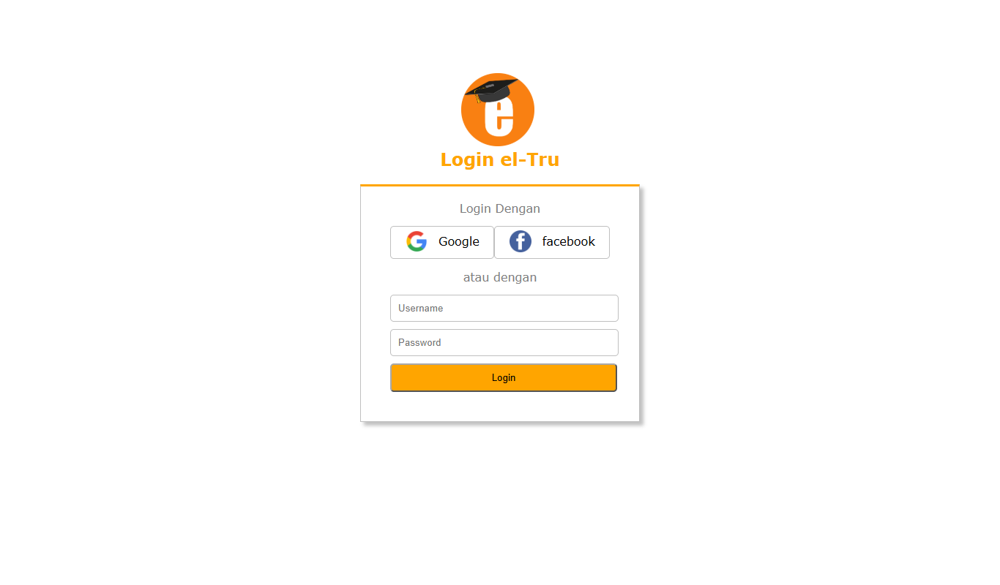 | 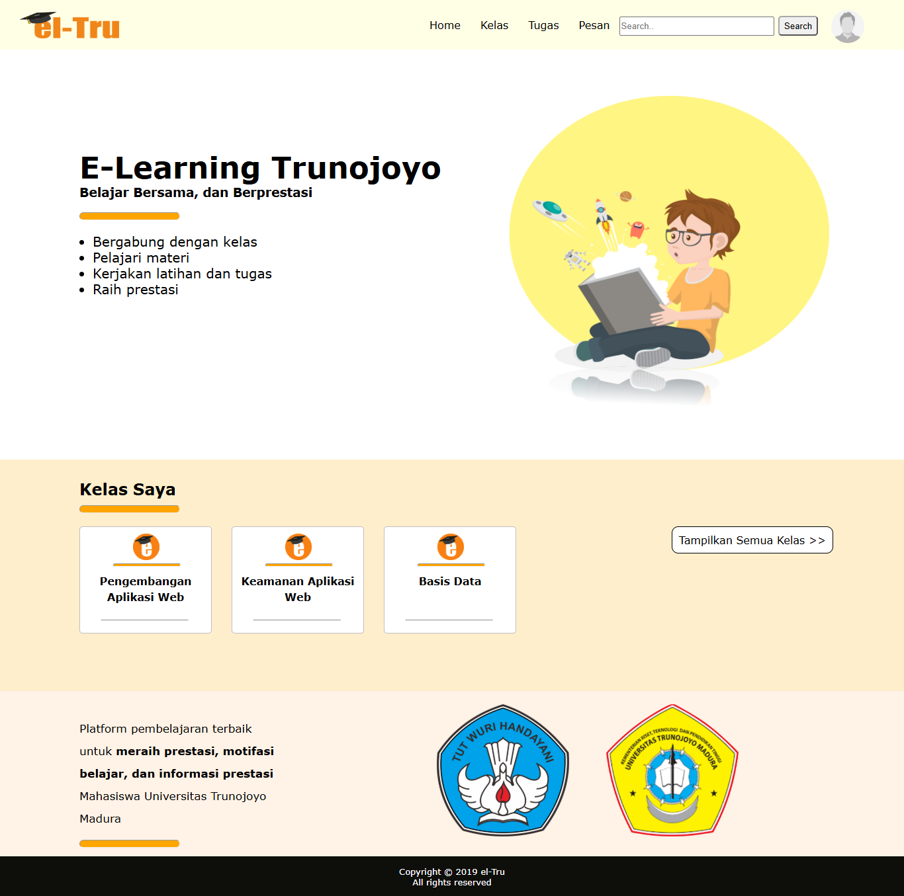 |

### Sebagai dosen

| Semua kelas | Buat kelas |
| :---: | :---: |
| 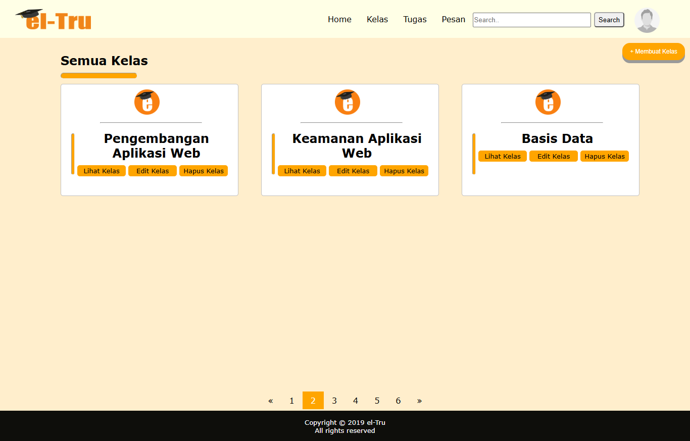 | 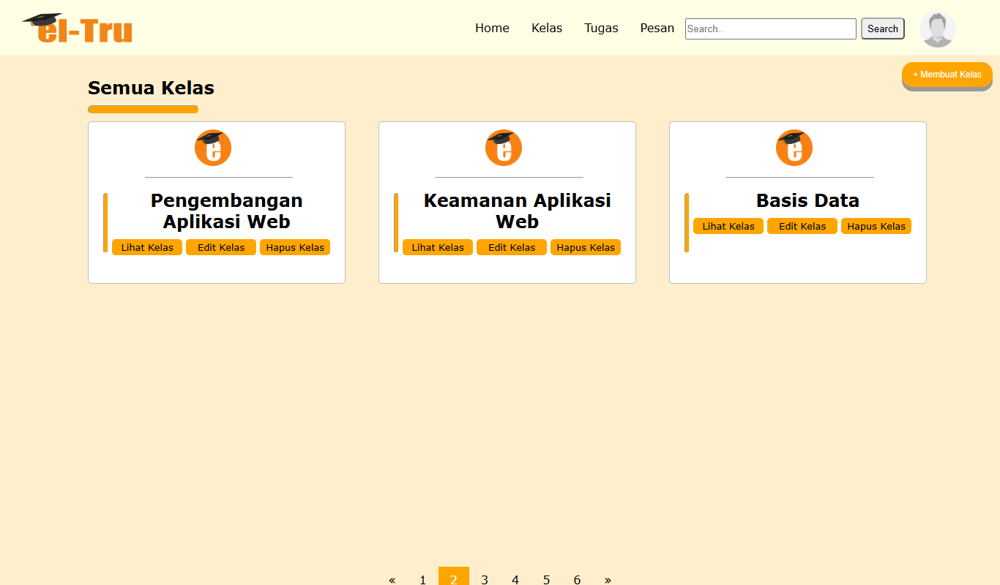 |

| Detail kelas & posting materi | Anggota kelas |
| :---: | :---: |
| 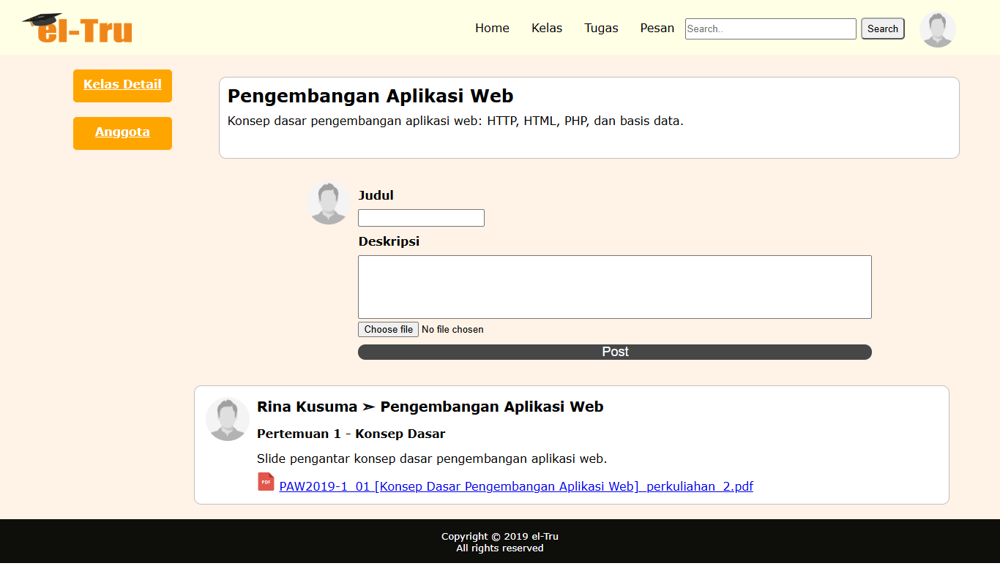 | 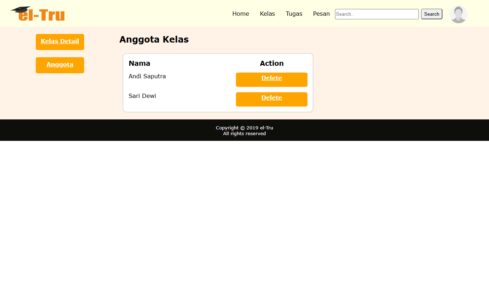 |

| Edit kelas | Profil |
| :---: | :---: |
| 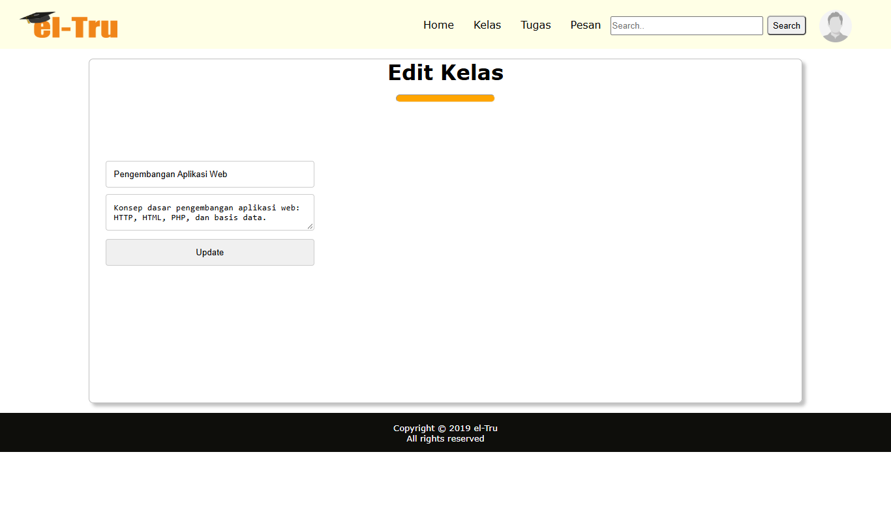 | 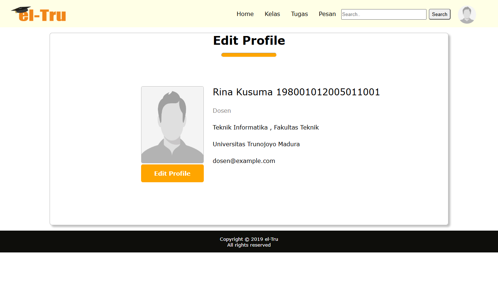 |

### Sebagai mahasiswa

| Semua kelas | Gabung kelas |
| :---: | :---: |
| 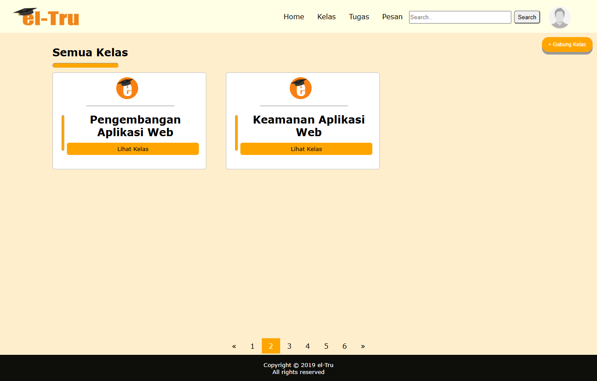 | 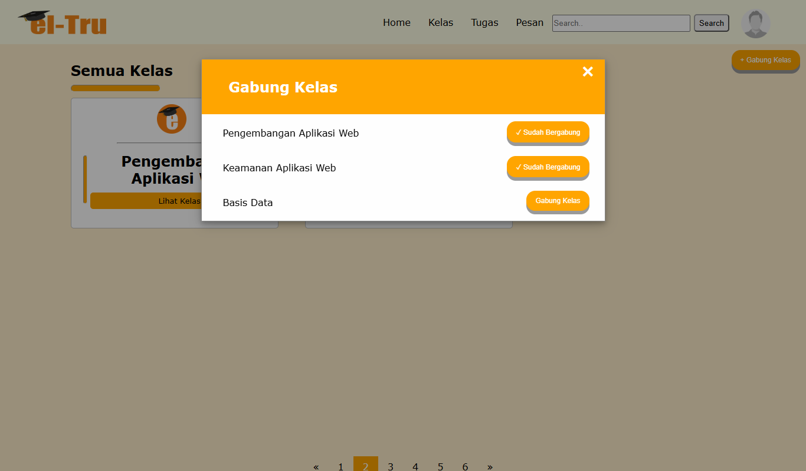 |

| Detail kelas (hanya melihat materi) | Edit profil |
| :---: | :---: |
| 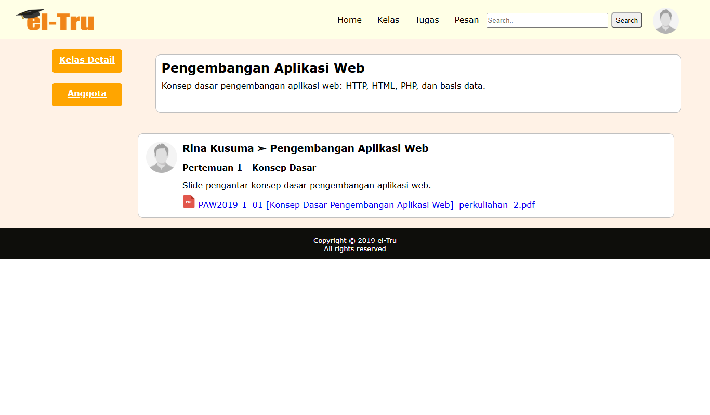 | 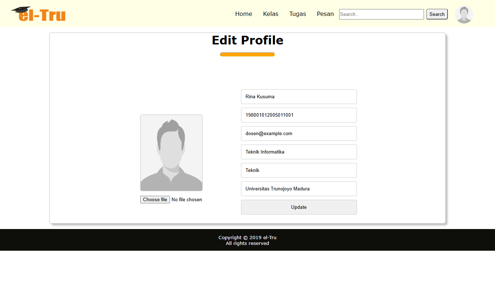 |

## Menjalankan di lokal

### Opsi A — Docker (disarankan)

Butuh [Docker](https://docs.docker.com/get-docker/) dengan Compose v2.

```bash
git clone https://github.com/wicakhendrik/ElTru.git
cd ElTru

cp .env.example .env        # lalu isi DB_PASS dan DB_ROOT_PASS dengan password acak
docker compose up -d --build
```

Isi data demo (opsional, tapi enak untuk mencoba):

```bash
docker compose exec -T db sh -c 'mysql -uroot -p"$MYSQL_ROOT_PASSWORD" "$MYSQL_DATABASE"' < database/seed-demo.sql
```

Buka **http://localhost:8088** lalu login dengan [akun demo](#akun-demo).

Perintah yang sering dipakai:

```bash
docker compose logs -f web     # log aplikasi
docker compose down            # hentikan (data tetap aman di volume)
docker compose down -v         # hentikan DAN hapus semua data (database + upload)
```

### Opsi B — Laragon / XAMPP (tanpa Docker)

1. Taruh folder proyek di `www` (Laragon) atau `htdocs` (XAMPP), misalnya `.../www/ElTru`.
2. Nyalakan Apache dan MySQL.
3. Buat database bernama **`elearning`**, lalu import `database/schema.sql`
   (dan `database/seed-demo.sql` untuk data demo).
4. Buka `http://localhost/ElTru/`.

Tanpa konfigurasi apa pun, koneksi memakai `localhost`, user `root`, tanpa password
(sama seperti versi aslinya). Untuk mengubahnya, set environment variable
`DB_HOST`, `DB_NAME`, `DB_USER`, `DB_PASS`.

> **Jangan** pakai `asset/eltru.sql` untuk setup. File itu adalah desain database awal (2019)
> yang sudah tidak cocok dengan kode. Pakai `database/schema.sql`.

## Akun demo

Dibuat oleh `database/seed-demo.sql`. **Hanya untuk lokal**; password-nya lemah.

| Peran | Username | Password |
| --- | --- | --- |
| Dosen | `dosen` | `dosen123` |
| Mahasiswa | `andi` | `andi123` |
| Mahasiswa | `mahasiswa` | `mhs12345` |

Aplikasi tidak punya halaman pendaftaran. Cara menambah user ada di [DEPLOY.md](DEPLOY.md#5-membuat-akun-dosen-sungguhan).

## Teknologi

- **Backend:** PHP native (tanpa framework), PDO untuk akses database. Teruji di PHP 8.2.
- **Database:** MySQL 8 (kompatibel dengan MariaDB).
- **Frontend:** HTML + CSS murni, sedikit JavaScript untuk modal.
- **Runtime:** Apache (image resmi `php:8.2-apache`), dikemas dengan Docker Compose.

## Struktur database

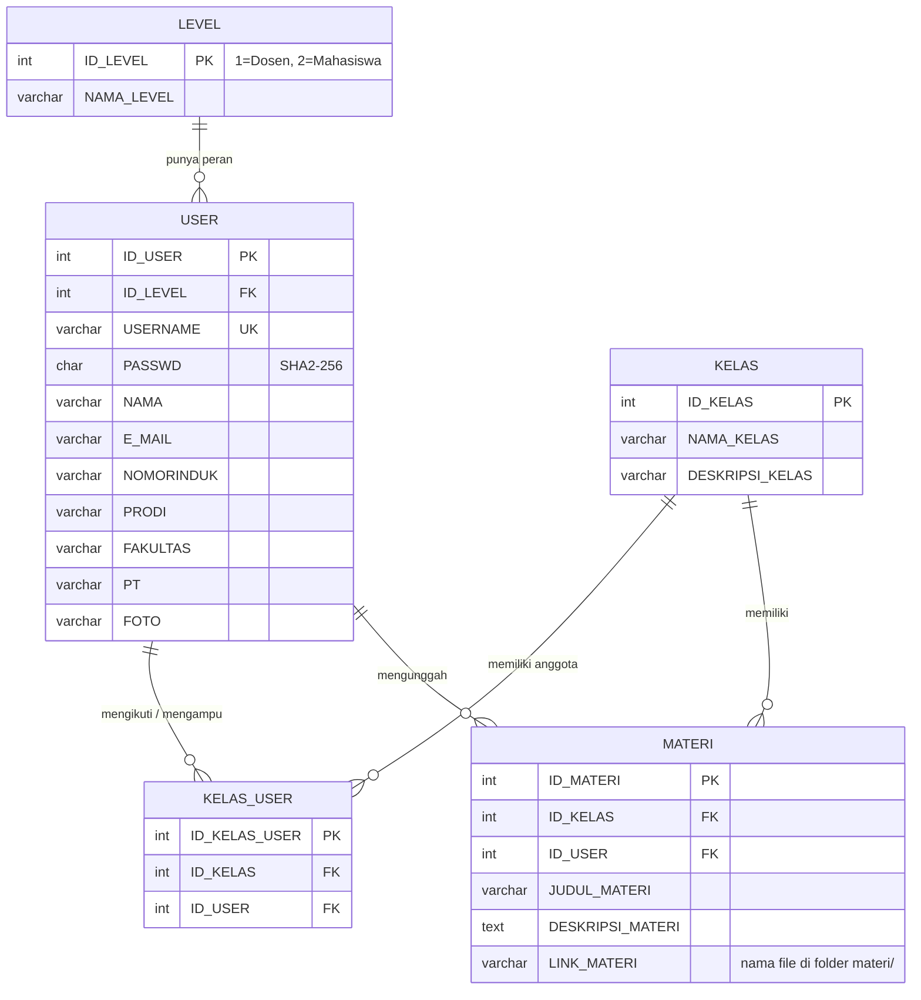

Seorang dosen "mengampu" kelas lewat baris di `kelas_user`, sama seperti mahasiswa yang bergabung.

## Struktur folder

```text
ElTru/
├── index.php            # kerangka halaman + router sederhana (?page=...)
├── koneksi.php          # koneksi PDO (baca env DB_*)
├── login/               # halaman login & logout
├── page/                # isi halaman: home, kelas, kelaspost, anggotamenu, profile, ...
├── function/            # fungsi form (buat/edit kelas, upload materi, dll) & validasi
├── css/style.css
├── asset/               # logo, ikon, foto profil (asset/user/)
├── materi/              # file materi yang diunggah dosen
├── database/
│   ├── schema.sql       # struktur tabel (sumber kebenaran)
│   └── seed-demo.sql    # data demo (opsional)
├── Dockerfile  docker-compose.yml  docker/php.ini  .env.example
├── DEPLOY.md            # panduan deploy lengkap (untuk VPS)
└── docs/screenshots/    # gambar di README ini
```

## Catatan & keterbatasan

Ini kode tugas kuliah dari 2019, jadi ada beberapa hal yang perlu diketahui:

- **Belum aman untuk internet publik.** Banyak query dirangkai dari input (rentan SQL injection),
  output belum di-escape (XSS), tidak ada proteksi CSRF, hapus kelas/anggota lewat link `GET`
  tanpa cek peran, dan password di-hash SHA-256 tanpa salt.
  Kalau dipasang di server, **batasi aksesnya** (basic auth, VPN, atau allowlist IP). Lihat [DEPLOY.md](DEPLOY.md#6-mengamankan-akses).
- Menu **Pesan**, **Tugas**, kotak **Search**, dan tombol login **Google/Facebook** hanya tampilan, belum ada fungsinya.
- Tidak ada pendaftaran akun; user dibuat langsung di database.
- Paginasi di halaman "Semua Kelas" hanya hiasan, dan daftar kelas dibatasi 6 item.
- Jika login salah tetapi formatnya valid, tidak ada pesan error yang muncul (perilaku asli).

Perubahan yang ditambahkan saat "menghidupkan kembali" proyek ini (logika aplikasi tidak diubah):

1. `koneksi.php` dan `function/function.php` membaca kredensial dari environment variable, dengan default lama.
2. Query `INSERT` yang mengisi ID auto-increment dengan `''` diganti `NULL`. MySQL 8 (strict mode) menolak `''`
   untuk kolom angka, sehingga buat kelas, gabung kelas, dan posting materi gagal.
3. Ditambahkan `database/schema.sql` yang direkonstruksi dari query di kode (dump aslinya tidak lengkap).

## Deploy ke server / VPS

Panduan langkah demi langkah ada di **[DEPLOY.md](DEPLOY.md)**: instalasi, HTTPS, backup,
update, dan troubleshooting.

---

<div align="center">

© 2019 el-Tru · Dibuat untuk tugas kuliah PAW, Universitas Trunojoyo Madura

</div>
